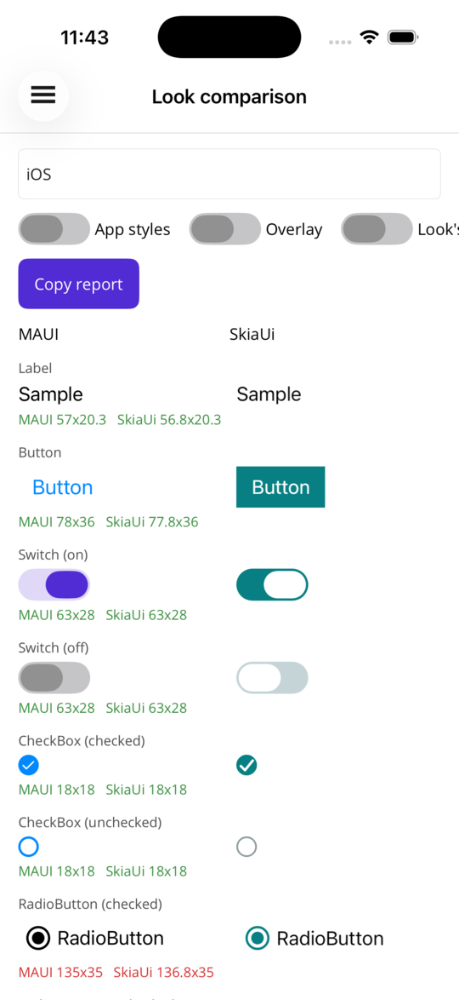
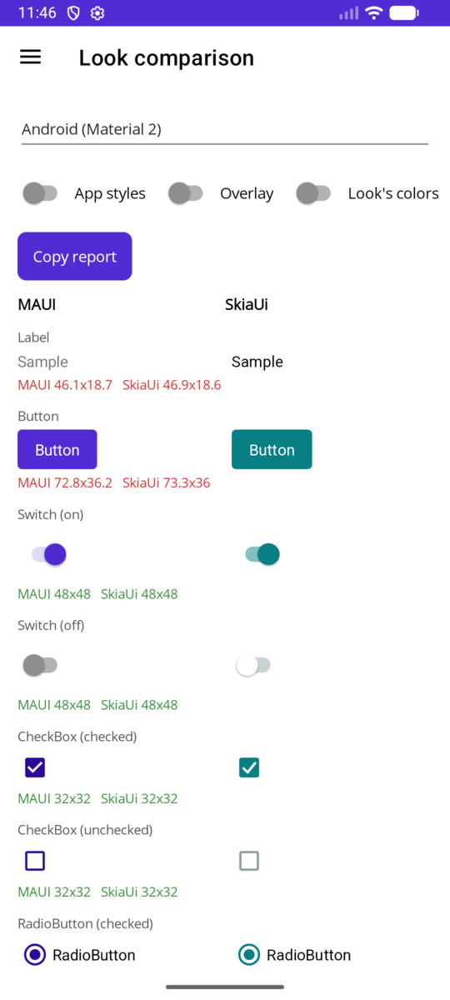
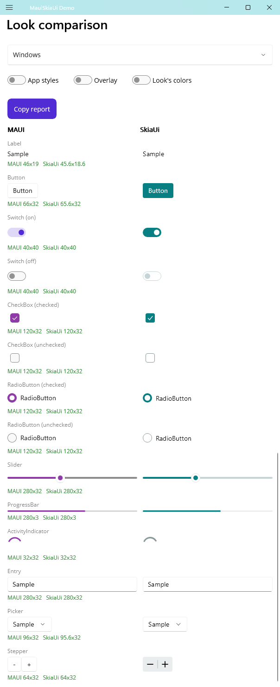

# Control look (shape / chrome)

How controls are drawn and sized (FR-18 in [Requirements.md](Requirements.md#functional-requirements)). Colors are the color scheme's: [ColorScheme.md](ColorScheme.md).

This is **not**:

- **Color scheme** ([ColorScheme.md](ColorScheme.md) / FR-19) — default palette (accent, backgrounds, …)
- **MAUI styles** (FR-12) — per-control `Style` / `VisualState` / resource setters

## Naming

| Term | Means | Does **not** mean |
| --- | --- | --- |
| **Control look** (`SkUiLook`) | Default **geometry and drawing** of Skia-drawn controls (switch pill vs Material track, radio ring vs filled disc, spinner arc vs dots, corner radii, checkmark path) **and**, where applicable, **default intrinsic width/height** | Color palettes; MAUI `Style` setters |
| **Color scheme** (FR-19) | Default colors for Core + MAUI controls | How a RadioButton is *drawn* |
| **Styles / VisualStates** (FR-12) | Bindable property overrides on individual `SkUi*` controls | Replacing shared geometry or the shared palette |

Prefer saying **“look”** or **“control look”** in docs and API. Avoid calling look packs “themes.”

## Goal

One **extensible look object** supplies the shared Skia painters **and default sizes** that both MAUI-compatible `SkUi*` and Core `SkUiCore*` controls use (replacing the former sealed `SkUiChrome` helpers + hardcoded `MeasureContent` sizes such as Switch 51×31). Apps can:

1. **Replace the entire look** — e.g. Android-like / iOS-like / Fluent / custom brand pack (shapes **and** default sizes where they differ).
2. **Override one control’s drawing and/or default size** — subclass and override `DrawRadioButton` / `MeasureRadioButton`, or replace a single painter / size delegate, without forking every control type.

Colors come from the **color scheme** (FR-19) and/or explicit control properties / FR-12 styles; the look receives already-resolved `SKColor`s and decides **shape**. Default **width/height** (intrinsic measure) come from the look when applicable.

## API

```csharp
// Public, subclassable. Built-in DefaultSkUiLook holds the default geometry + sizes (formerly SkUiChrome).
public class SkUiLook
{
    // Controls call the public, non-virtual entry points; each uses its painter delegate when set,
    // else the protected virtual *Core method that subclasses override. Each takes one paint struct
    // (room to grow without new overloads). Colors arrive resolved (disabled dimming applied).
    // Phase D's paints (text fields, search field, handles, steppers) are init-only properties, not positional records, so
    // members added in 1.x do not change a constructor or Deconstruct; the older ones are still positional.
    public void DrawSwitch(SKCanvas canvas, SkUiSwitchPaint toggle) { … }            // → SwitchPainter ?? DrawSwitchCore
    public void DrawCheckBox(SKCanvas canvas, SkUiCheckBoxPaint box) { … }           // → CheckBoxPainter ?? DrawCheckBoxCore
    public void DrawRadioButton(SKCanvas canvas, SkUiRadioButtonPaint radio) { … }   // → RadioButtonPainter ?? DrawRadioButtonCore
    public void DrawButton(SKCanvas canvas, SkUiButtonPaint button) { … }            // fill (FillPaint: a gradient Background), border, press feedback → ButtonPainter ?? DrawButtonCore
    public void DrawPressOverlay(SKCanvas canvas, SkUiPressOverlayPaint overlay) { … } // over content: ImageButton, ShowsPressEffect → PressOverlayPainter ?? DrawPressOverlayCore
    // Slider / ProgressBar draw in horizontal left-to-right coordinates: the controls rotate the canvas for
    // vertical sliders and mirror RTL.
    public void DrawSlider(SKCanvas canvas, SkUiSliderPaint slider) { … }            // → SliderPainter ?? DrawSliderCore
    public void DrawProgressBar(SKCanvas canvas, SkUiProgressBarPaint bar) { … }     // → ProgressBarPainter ?? DrawProgressBarCore
    public void DrawDragger(SKCanvas canvas, SkUiDraggerPaint dragger) { … }         // → DraggerPainter ?? DrawDraggerCore (also grid splitters; may draw in TouchBounds, past a thin dragger)
    public void DrawActivityIndicator(…) { … }                                      // → ActivityIndicatorPainter ?? DrawActivityIndicatorCore
    // Scroll bar thumbs: drawn once per length and color into a Core node; the compositor moves and fades it.
    public void DrawScrollBar(SKCanvas canvas, SkUiScrollBarPaint bar) { … }         // → ScrollBarPainter ?? DrawScrollBarCore
    public void DrawScrollBarTrack(SKCanvas canvas, SkUiScrollBarTrackPaint track) { … } // expanded bars (hover) → ScrollBarTrackPainter ?? DrawScrollBarTrackCore
    // Pull-to-refresh indicator (SkUiCoreRefreshIndicator): recorded once per state; a pull shows through
    // GetRefreshPullFeedback (composite opacity / rotation) unless RefreshIndicatorDrawsPullProgress; spun while refreshing.
    // Default: DrawActivityIndicator, on a badge of the default background as an overlay, bare inline.
    public void DrawRefreshIndicator(SKCanvas canvas, SkUiRefreshIndicatorPaint paint) { … } // → RefreshIndicatorPainter ?? DrawRefreshIndicatorCore
    public virtual double RefreshIndicatorSize => 40;      // and RefreshTriggerDistance (64), RefreshRestDistance (64),
                                                           // RefreshIndicatorSpinPeriod (1 s), GetRefreshIndicatorShadow(style)
    public virtual SkUiRefreshStyle DefaultRefreshStyle => SkUiRefreshStyle.Overlay; // DefaultSkUiLook: BaseRefreshStyle (Overlay; Inline in the Apple looks)
    // Reordering (collection views): the lifted item's scale and shadow, set on its copy (composite-time), and auto-scroll.
    public virtual double ReorderLiftScale => 1;           // DefaultSkUiLook: 1.03; and GetReorderLiftShadow() (DefaultSkUiLook: a soft shadow)
    public virtual double ReorderAutoScrollZone => 48;     // and ReorderAutoScrollSpeed (1200 DIPs/s at the very end)
    // Indicator views (C4): the whole row, laid out by the control (SkUiIndicatorPaint.GetIndicatorBounds / GetSelection /
    // GetColor, as hit-tested); drawn again while the selection moves. DefaultSkUiLook: dots or a pill (IndicatorStyle).
    public void DrawIndicators(SKCanvas canvas, SkUiIndicatorPaint paint) { … } // → IndicatorPainter ?? DrawIndicatorsCore
    public virtual double DefaultIndicatorSpacing => 8;    // and GetSelectedIndicatorExtraLength(size, shape) (a pill's room)
    // Avatars (C8): the intrinsic size, the text size for the content area, colors by mode and name (palette index by a
    // stable hash: AvatarPaletteIndex), and the status badge over the border on the outline's corner arc.
    public virtual Size DefaultAvatarSize => new(48, 48);  // and GetAvatarFontSize(content) (40 % of the smaller side)
    public virtual SkUiAvatarColors GetAvatarColors(SkUiAvatarColorMode mode, string? key) { … } // Default: TrackOff / DefaultForeground
    public void DrawAvatarBadge(SKCanvas canvas, SkUiAvatarBadgePaint paint) { … } // → AvatarBadgePainter ?? DrawAvatarBadgeCore
                                                           // GetAvatarBadgeBounds(avatar, position, cornerRadius), GetAvatarBadgeRingWidth
    // Shimmers (C9): default colors from the scheme, the default wave's tilt, and the wave band's shader: made once when a
    // shimmer's wave changes (per bone in Bones mode); the band filled with it is moved on the render thread.
    public virtual SkUiShimmerColors GetShimmerColors() { … } // Bone: TrackOff halfway to the background; Highlight: lighter
    public virtual double ShimmerWaveTilt => 20;
    public SKShader CreateShimmerWaveShader(SkUiShimmerWavePaint wave) { … } // → ShimmerWaveShader ?? CreateShimmerWaveShaderCore
    // Skeletons from the content (C9b): a control's part (a text line, a shape, a switch, a slider…) to rounded-rectangle
    // bones, when its size, text or skeleton changes (not per frame); the shimmer draws them with its effect.
    public void AddSkeletonBones(SkUiSkeletonPart part, IList<SkUiSkeletonBone> bones) { … } // → SkeletonBones ?? AddSkeletonBonesCore
    // Picker fields (C6): chrome and chevron behind the control's text; Focused / Open animate (FieldFocus, PickerOpen).
    // DefaultSkUiLook: PickerFieldStyle (Default → DefaultPickerFieldStyle: outline; underline, filled, none);
    // AndroidSkUiLook: underline. A picker's own FieldStyle and chrome (M5) come in field.Style / field.Chrome.
    public void DrawPickerField(SKCanvas canvas, SkUiPickerFieldPaint field) { … } // → PickerFieldPainter ?? DrawPickerFieldCore
    public virtual Thickness PickerFieldPadding => new(12, 8); // and PickerChevronWidth (32), DefaultPickerMinimumHeight (44)
    // Text fields (Phase D, TextInput.md): chrome behind the text, as the picker field's (FieldFocus);
    // DefaultSkUiLook: TextFieldStyle (Default → DefaultTextFieldStyle: outline; underline, filled); AndroidSkUiLook: underline.
    // A field's own FieldStyle wins; its FillColor / BorderColor / BorderWidth / CornerRadii come in field.Chrome (SkUiFieldChrome).
    public void DrawTextField(SKCanvas canvas, SkUiTextFieldPaint field) { … }      // → TextFieldPainter ?? DrawTextFieldCore
    public virtual Thickness TextFieldPadding => new(12, 8); // and DefaultTextFieldMinimumHeight (44), TextFieldClearButtonWidth (32)
    public virtual double CaretWidth => 2;                 // and CaretBlinkInterval (500 ms; zero: no blink), DefaultCaretColor, DefaultSelectionColor
    public void DrawTextFieldClearButton(…) { … }          // → TextFieldClearButtonPainter
    public void DrawTextSelectionHandle(SKCanvas canvas, SkUiTextSelectionHandlePaint handle) { … } // touch handles (a bar and a knob);
                                                           // TextSelectionHandleTouchRadius (22), GetTextSelectionHandleBounds
    public void DrawTextInsertionHandle(SKCanvas canvas, SkUiTextInsertionHandlePaint handle) { … } // the caret's drop (Android);
                                                           // ShowsTextInsertionHandle, GetTextInsertionHandleBounds, TextInsertionHandleTimeout (4 s)
    public void DrawSearchField(SKCanvas canvas, SkUiSearchFieldPaint field) { … }  // a pill with a magnifier; SearchIconWidth (28)
    // Stepper (D7): two segments with − and + (or none where the control draws its text), side by side or stacked, a divider,
    // pressed / disabled per button, focus; the control's corner radius and outline (width, color), the divider then in the outline's.
    public void DrawStepper(SKCanvas canvas, SkUiStepperPaint stepper) { … }
    public virtual Size StepperButtonSize => new(47, 32);  // and StepperRepeatDelay (400 ms), StepperRepeatInterval (100 ms)
    public virtual double DefaultStepperCornerRadius => 8; // until the stepper's CornerRadius is set
    // Popups of drawn controls (C6): where they go and what they look like; the app's presenter shows them.
    public virtual SkUiPopupPlacement DefaultPopupPlacement => SkUiPopupPlacement.Anchored; // DefaultSkUiLook: the device's
    public virtual Thickness PopupMargin => new(8);         // and PopupAnchorGap (4), PopupPreferredWidth (320),
                                                           // PopupHorizontalOptions / PopupVerticalOptions, PopupItemHeight (44),
                                                           // PopupItemPadding, PopupHighlightColor, GetPopupOverlayColor(placement)
    // Keyboard focus ring over the focused drawn control (P10), inside its bounds, while focus came from the keyboard.
    public void DrawFocusRing(SKCanvas canvas, SkUiFocusRingPaint ring) { … }        // → FocusRingPainter ?? DrawFocusRingCore
    public virtual double ScrollBarThickness => 4;         // and ScrollBarMargin (2), ScrollBarMinimumThumbLength (24),
                                                           // ScrollBarExpandedThickness (8), ScrollBarHitThickness (16),
                                                           // ScrollBarReservedThickness (12: the gutter of a bar that always shows)
    public virtual TimeSpan ScrollBarFadeDelay => TimeSpan.FromMilliseconds(500);     // and ScrollBarFadeDuration (250 ms)
    public virtual SkUiOverscrollMode DefaultOverscroll => SkUiOverscrollMode.None; // DefaultSkUiLook: BaseOverscroll (None; Bounce in the Apple looks, Stretch in Android's)
    public virtual float SliderThumbRadius => 10;         // input maps touches to the thumb's center
    public virtual float IndeterminateProgressSegment => 0.35f;
    public virtual float IndeterminateProgressPeriod => 1.5f; // seconds; the compositor slides the bar on the render thread
    public virtual float GetProgressBarCornerRadius(float height) => height / 2;
    public void DrawRoundedBox(…) { … }      // float radius and CornerRadius overloads → DrawRoundedBoxCore;
                                             // a Paint fill (gradients) → DrawRoundedBoxCore(…, Paint, …), solid paints take the color path
    public virtual SKPath? CreateCustomRoundRectPath(SKRect bounds, CornerRadius radii) => null; // custom corner geometry (null = plain)
    public SKPath CreateRoundRectPath(…) { … } // uniform or per-corner: custom geometry, else plain corners
    public void DrawImage(…) { … }           // → ImagePainter ?? DrawImageCore

    // State-change transitions (below): duration + easing per kind; None while reduce motion is on.
    public SkUiTransition GetTransition(SkUiTransitionKind kind) { … }  // → TransitionProvider ?? GetTransitionCore

    // Default intrinsic sizes (DIPs) — public size tokens; Measure* reads these unless a size delegate is set.
    public virtual Size DefaultSwitchSize => new(51, 31);
    public virtual Size DefaultCheckBoxSize => new(24, 24);
    public virtual Size DefaultRadioButtonSize => new(24, 24);
    public virtual double DefaultRadioButtonContentSpacing => 8;   // circle to Content (text or a drawn view)
    public virtual Size DefaultActivityIndicatorSize => new(36, 36);
    public virtual double DefaultSliderThickness => 32;   // and DefaultSliderLength when unconstrained
    public virtual double DefaultProgressBarHeight => 4;  // and DefaultProgressBarLength
    public virtual double DefaultButtonMinimumHeight => 44;
    public virtual double DefaultButtonCornerRadius => 6;
    public virtual double DisabledButtonContentOpacity => 0.38;   // a disabled button without a fill: its text and image

    public Size MeasureSwitch(double widthConstraint, double heightConstraint) =>
        SwitchMeasure?.Invoke(widthConstraint, heightConstraint) ?? MeasureSwitchCore(widthConstraint, heightConstraint);
    protected virtual Size MeasureSwitchCore(double widthConstraint, double heightConstraint) => DefaultSwitchSize;
    // … same pattern for CheckBox / RadioButton / ActivityIndicator
}

// App-wide current look.
SkUiLook.Current = new MaterialSkUiLook();

// Partial replace via subclass:
sealed class AppLook : DefaultSkUiLook
{
    protected override void DrawRadioButtonCore(SKCanvas canvas, SkUiRadioButtonPaint radio) { /* brand radio */ }
    public override Size DefaultSwitchSize => new(52, 32); // larger track
}

// Or per-painter / per-size delegates on the look instance:
look.RadioButtonPainter = (canvas, radio) => { … };
look.SwitchMeasure = (w, h) => new Size(52, 32);
```

Controls call **`SkUiLook.Current` (or an inherited / attached look)** for both paint and default measure instead of a sealed static `SkUiChrome` and hardcoded sizes. Keep a thin compatibility façade if needed during migration.

### State-change transitions (FR-26)

Looks draw every point of a transition, not only the resting states. Switches, check boxes and radio buttons slide or draw in between states; buttons dim or ripple while pressed; slider thumbs glide to tapped values; progress bars can smooth `Progress` changes.

**Gradient fills (P7).** A gradient `Background` reaches the look as a MAUI Graphics `Paint`: `SkUiButtonPaint.FillPaint` (with `Fill` holding the stops averaged, so color-only painters keep working), and the `DrawRoundedBox(canvas, bounds, radii, Paint? fill, border, width)` overload used by label, button and image-button chrome. The base look fills its rounded geometry (`CreateRoundRectPath`, so custom corners apply) with the gradient and draws the border as with a transparent fill; `DefaultSkUiLook` dims gradients as it dims colors when pressed. Shadows and clips are not look entry points: the compositor draws them from MAUI's `Shadow` / `Clip` and the control's silhouette.

**What a painter receives.**

| Paint struct | Transition data | Helpers |
| --- | --- | --- |
| `SkUiSwitchPaint`, `SkUiCheckBoxPaint`, `SkUiRadioButtonPaint` | `Visual` (`SkUiToggleVisual`): `State` (target), `From`, `Progress` (eased, 1 = settled), `Pressed` (0–1) | `Weight(state)`: how much of a state shows (the weights add up to 1). `Blend(u, c, i)`: numbers or colors per state, blended |
| `SkUiButtonPaint`, `SkUiPressOverlayPaint` | `Press` (`SkUiPressVisual`): `Pressed` (0–1), `Origin` (press point), `Ripple` (spread 0–1), `RippleFade` (0 visible, 1 gone) | `HasRipple` |
| `SkUiSliderPaint` | `Fraction` is the drawn position (glides after a tap); `Pressed` (0–1) while dragged | — |
| `SkUiProgressBarPaint` | `Progress` is the drawn fill | — |

Drawing the blend makes interruptions free: a switch toggled back mid-way reverses from where it is. (A third state mid-way, only possible with three-state toggles, starts again from the nearer of the two states.)

**How long, which curve.** `GetTransition(kind)` returns a `SkUiTransition(Duration, Easing)`; `None` (zero duration) turns a transition off. Kinds: `Switch`, `CheckBox`, `RadioButton`, `Press`, `Release`, `Ripple`, `SliderThumb`, `Progress`, `IndicatorPosition`, `FieldFocus`, `PickerOpen`, `ReorderLift`, `ReorderMove`, `ImageFadeIn`.

| Kind | `DefaultSkUiLook` |
| --- | --- |
| Switch | 200 ms, cubic in-out |
| CheckBox, RadioButton | 160 ms, cubic in-out |
| Press / Release | 80 ms / 220 ms, cubic out (a quick tap still shows its full press) |
| Ripple | 450 ms, cubic out (only with `PressEffect = Ripple`, else none: no frames spent) |
| SliderThumb | 150 ms, cubic out (taps only; drags and code follow at once) |
| IndicatorPosition | 250 ms, cubic out (an indicator view's selection; a linked carousel's scrolling drives it instead) |
| FieldFocus | 150 ms, cubic out (a picker field's focus and open highlight, a text field's focus) |
| PickerOpen | 200 ms, cubic in-out (a picker's chevron turns while its popup opens and closes) |
| ReorderLift | 150 ms, cubic out (a collection view item lifted to be reordered scales to `ReorderLiftScale`, and back when put down) |
| ReorderMove | 200 ms, cubic out (items move aside from a dragged item; the dropped item goes to its place) |
| ImageFadeIn | 200 ms, cubic out (a loaded image fades in, with `FadeAnimationEnabled`; its `FadeAnimationDuration` replaces the duration) |
| Progress | None, as MAUI's `ProgressBar` (`ProgressTo` animates on its own) |

**Press feedback on any control.** `ShowsPressEffect` (every `SkUiView` and Core node) draws the look's press overlay (`DrawPressOverlay`) over the node and its children while it is pressed, clipped to its rounded shape (a label's `CornerRadii`, a border's `CornerRadius` or rounded-rectangle `StrokeShape`). This is for containers that act as one button: a card, or a composite button built from several Core nodes. The node needs a tap handler (`Tapped`, or `TappedCommand` on SkUi*) to be pressed. A button inside it still takes its own presses. `DefaultSkUiLook` dims the content or spreads a dark ripple. On dark content (a dark icon glyph) a dark tint hardly shows: `PressFeedback = Fade` draws no overlay and fades the node and its children to the look's `PressedContentOpacity` (0.4) with the press and release transitions instead. The fade is a composite-time factor (`SkUiRenderProps.PressOpacity`, apart from `Opacity`, so an opacity animation and the fade leave each other alone): its frames mark only the node's props dirty and re-record nothing.

Override `GetTransitionCore` in a subclass, or set `TransitionProvider` on a look instance. `DefaultSkUiLook.PressEffect` picks `Dim` (a dark or colored fill fades by a quarter; a light or mostly see-through one, which fading would leave the page's color, darkens under the press overlay's tint instead) or `Ripple` (a circle spreads from the press point, clipped to the button's rounded shape, and fades after the release); its default, `Default`, is the look's `BasePressEffect` (`Dim`; Android's look ripples). The platform looks also time their transitions: Android uses Material's emphasized curves (`SkUiEasings.Emphasized`), the Apple looks iOS's spring-like curve, Windows Fluent's short decelerating one; the numbers above are the default look's.

**Reduce motion.** `SkUiMotion.IsMotionReduced` follows the OS setting (iOS / Mac Catalyst Reduce Motion, Android "Remove animations", Windows animation effects off); `SkUiMotion.ReduceMotion` overrides it. While reduced, `GetTransition` returns `None` for every kind. Activity animations (spinners, the indeterminate progress bar) keep running, since they show that work is in progress.

**Where it runs.**
- Transitions run on the surface's UI-thread animation clock. Each frame re-records only the animating control's picture (ancestors are not re-recorded), and the rest of the tree is composited from retained pictures. Painters stay ordinary single-threaded code.
- Controls animate only after they have been drawn on a surface. A state set before a page appears (a constructor, a binding) shows at once.
- Stopping the clock (the page closes, the surface is replaced) jumps every transition to its end state.
- The decision and its measurements: [ArchitectureReview-2026-09.md](../archive/ArchitectureReview-2026-09.md#state-change-animations) (archived).

### Text prescale

`FontScale` (default 1, settable on any look) multiplies every drawn text size of the app: labels, buttons, radio button text, spans, HTML and font images on both layers, with or without `FontAutoScalingEnabled` (an app's own text size setting). Text that auto scales then gets the system text size on top ([Accessibility.md](Accessibility.md#font-scaling)). Setting it on the current look redraws live surfaces; a look swap applies the new look's value.

### Focus ring

The control with keyboard focus (either layer: buttons, toggles, sliders, views with a tap handler) gets the look's ring in its overlay layer while focus came from the keyboard: `DrawFocusRing(canvas, SkUiFocusRingPaint)` with the control's rectangle, its corner radii (labels, buttons, borders: their own; others square) and two colors from the color scheme (`Color`: foreground, `Contrast`: background). `DefaultSkUiLook` draws a `FocusRingThickness` (2 DIP) line of the foreground with a 1 DIP background line inside it, both inside the bounds (leaf controls clip to them), following the corners, so the ring shows on light, dark and accent fills, as Windows' focus visuals. Replace it with `FocusRingPainter` or by overriding `DrawFocusRingCore`. Showing or hiding the ring re-records the control once; see [Accessibility.md](Accessibility.md#keyboard-focus).

### Default width / height

Where a control has a meaningful **intrinsic** or **default** size (Switch, CheckBox, RadioButton, ActivityIndicator, button minimum height, default corner radius, …):

- The **active look** owns those defaults.
- Apps may override them by replacing the look, subclassing and overriding the measure/size members, or replacing a size delegate.
- Explicit control size requests (`Width` / `Height` / `WidthRequest` / `MinimumHeight`, fluent `SetWidth`, …) still win over look defaults for that instance.
- Changing a look’s sizes must **invalidate measure** (and paint when drawing also changes).

## Resolution

1. The `Look` of the node or its nearest drawn ancestor that sets one (`SkUiView.Look`, `SkUiCoreNode.Look`); measuring and recording a node run with it as `SkUiLook.Current` on the thread (`SkUiLookScope`).
2. Else **`SkUiLook.Current`** (app-wide; `UseSkiaUi(options => options.Look = …)`).
3. Else the built-in **`DefaultSkUiLook`**.

Changing the active look re-measures and redraws every live surface (each standalone root re-marks its drawn tree on `CurrentChanged`). After changing the current look **in place** (sizes, painters, `PressEffect`), call `SkUiLook.NotifyChanged()`.

## Relationship to layers (FR-9) and color scheme (FR-19)

Look methods are the **shared Content/Background chrome implementations**. Controls still own:

- Which phase calls which painter (`OnPaintContent` vs `PaintBackground` / `PaintOverlay`).
- Property state (`CheckState`, colors, `IsEnabled` alpha) and the transition state they pass to the look.
- Interaction / commands.

Looks do **not** replace `PaintBackground` / `OnPaintContent` hooks; they are what those hooks call for stock geometry. Looks do **not** own the palette — that is **FR-19**.

## Built-in looks

| Pack | Intent |
| --- | --- |
| `DefaultSkUiLook` | Cross-platform geometry and sizes (the former `SkUiChrome` painters + hardcoded measures), **the same on every platform** by default |
| Platform looks: `AndroidSkUiLook`, `AndroidMaterial3SkUiLook`, `IosSkUiLook`, `MacSkUiLook`, `WindowsSkUiLook` | Subclasses of `DefaultSkUiLook` that mimic MAUI's native controls on one platform each, measured on devices with `SkUiLookComparisonPage` (below); they draw the same wherever they run. `DefaultSkUiLook.ForCurrentPlatform()` returns the one for the platform the app runs on (shared instances; `UseSkiaUi(options => options.Look = …)` or `SkUiLook.Current` makes it current). iOS: iOS 26. Mac: Mac Catalyst in the iPad idiom (MAUI's default), where Catalyst draws the iOS controls at 77%, so `MacSkUiLook` derives from `IosSkUiLook`. Android: Material 2 as MAUI ships it; `AndroidMaterial3SkUiLook` (derived from it) for `<UseMaterial3>true</UseMaterial3>`, which `ForCurrentPlatform` detects. Windows: MAUI on Windows 11 (WinUI 3, Fluent) |
| App / library packs | Brand-specific subclasses (of the default look or a platform look) or delegate replacements |

A look owns shapes, sizes and motion; the colors are the color scheme's. For the platform's appearance, set both: the platform look, and its scheme before the first page's controls are created (the platform schemes also carry the native button and activity indicator colors):

```csharp
var look = DefaultSkUiLook.ForCurrentPlatform();
builder.UseSkiaUi(options => options.Look = look);
// In the App constructor, before MainPage / the shell is created:
SkUiColorScheme.Current = look.GetColorScheme(RequestedTheme == AppTheme.Dark);
```

Platform-specific choices belong in the platform looks, not in `DefaultSkUiLook`: an option of the default look (such as `PickerFieldStyle`) resolves its `Default` value through a virtual (`DefaultPickerFieldStyle`) the platform looks override. Choices that depend on the device rather than the platform (a phone, a tablet, a desktop) can stay in the default look (`DevicePopupPlacement`). The overscroll (`BaseOverscroll`) and pull-to-refresh style (`BaseRefreshStyle`) follow the same pattern: the default look stops at the edge and shows an overlay badge everywhere; the Apple looks bounce with an inline indicator, Android's stretches.

A control can override such an option for itself (M5): a text field's or picker's own `FieldStyle` wins over the look's `TextFieldStyle` / `PickerFieldStyle`, which wins over the look's `Default…` virtual; its own idle chrome (`FillColor`, `BorderColor`, `BorderWidth`, `CornerRadii`) reaches the look in the paint (`SkUiFieldChrome`), so a look or painter draws it with its own focus, error and disabled emphasis. A control's own `TextPadding` replaces the look's `TextFieldPadding` in the field's layout.

## Matching MAUI's native controls

The platform looks take their sizes from MAUI's native controls as they measure and draw on each platform, not from the design guidelines alone (MAUI's iOS buttons have square corners, its Android check box sits in 32 dp, its pickers have no arrow). `SkUiLookComparisonPage` is the tool: one row per control with the native control (the platform the app runs on) next to the drawn one under a chosen look, both measured sizes (green when they match within 0.5 DIP), side by side or overlaid at half opacity, with the app's implicit styles or the platform's defaults (empty implicit styles on both sides), and optionally the look's color scheme. Apps add their own look (`AddLook`) and their own pairs of styled controls (`AddRow`). After each layout it writes a report to the console (`[SkUiLookComparison]` lines) and keeps it for "Copy report"; the `skiaui-look` agent skill (plugins/skiaui-migration) runs it on simulators and emulators, summarizes the reports and tunes a look until every row matches. The demo shows it as "Look comparison" (route `look-comparison`, `SKUI_LOOK` / `SKUI_APP_STYLES` / `SKUI_OVERLAY` for scripted runs).

Text needed two engine options to measure as native labels do, both look members: `TextIncludesFontPadding` (Android's TextView adds the font's top and bottom extents to the first and last lines: Roboto's 14 sp line is 18.7, not 16.4; spans and HTML too, from the tallest span's font on those lines) and `AppliesFontTracking` (CoreText applies the font's `trak` table, which HarfBuzz does not: SF is 0.43 pt tighter per character at 17 pt; `FontTrackingSizeScale` looks the tracking up at Mac Catalyst's drawn size, 77%). On Apple platforms text that sets no family uses `.AppleSystemUIFont` (SF with UIKit's metrics); Skia's default face there is Helvetica.

 

On Windows the native controls keep WinUI's own minimums: a check box and a radio button are at least 120 wide (WinUI's `MinWidth`), which a `MinimumWidthRequest` replaces rather than raises, as MAUI maps it to `MinWidth`. `SkUiLook.DefaultCheckBoxMinimumWidth` and `DefaultRadioButtonMinimumWidth` give way the same way. Fluent's shapes needed their own options: `SkUiRadioButtonStyle.Filled` (the ring fills with the accent around a white dot), `SliderThumbInnerRadius` (a white thumb around an accent dot), `ProgressBarTrackLineHeight` (a 1 epx track under the 3 epx fill), `SkUiTextFieldStyle.TextBox` and the `ComboBox` picker field (Fluent's control fill, a faint outline with a darker bottom edge, an accent line while focused), `CheckMarkStrokeFraction` and `CheckMarkScale` (the thin check glyph), and the `Ring` activity indicator without a track.



Known differences: Android text measures up to 1–2% wider than a TextView's; on Android and Windows the Stepper keeps SkiaUi's segmented look instead of MAUI's two separate buttons (a choice, not a gap). Colors are the color scheme's: the platform schemes' control tokens (`ButtonBackground`, `ButtonForeground`, `ButtonBorder`, `ActivityIndicator`; [ColorScheme.md](ColorScheme.md#built-in-schemes)) give buttons and activity indicators the native colors, and the look draws the button's border (`DefaultButtonBorderWidth`, `ButtonHasElevationBorder`: Windows' 1 epx border, darker along the bottom). Compare them with the page's "Look's colors" on. The schemes do not read the user's system accent (Windows, Android 12+): pass it to `WithAccent`.

## Core

Core and SkUi\* controls use the same look resolution and the same painters, so both layers draw the same pixels.

## Non-goals

- Owning color tokens (FR-19 / [ColorScheme.md](ColorScheme.md)).
- Replacing FR-12 MAUI `Style` for per-control property overrides.
- Full native design-system parity (Material 3 / Cupertino every detail).
- Per-frame look allocation (look instances should be long-lived; hot path = virtual call / delegate invoke only).
